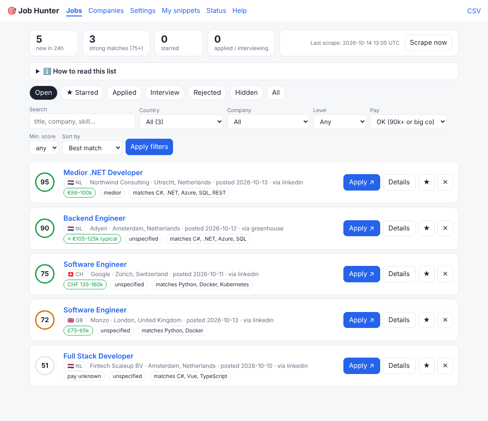
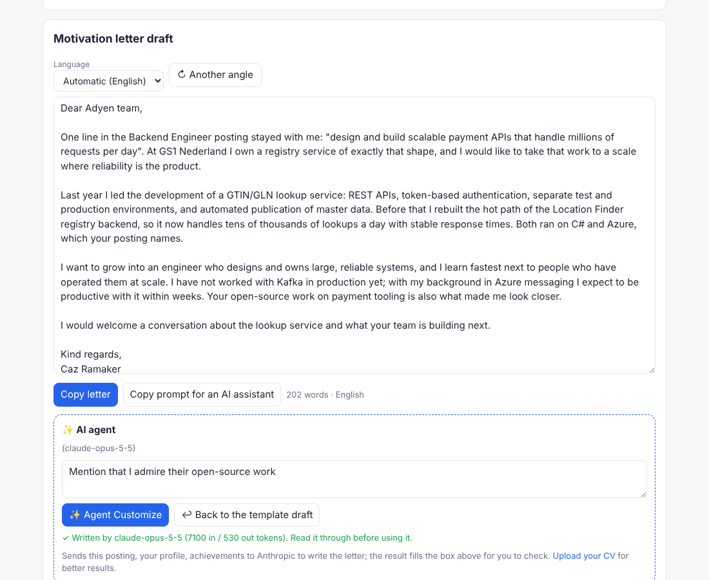

# Job Hunter

A small self-hosted job board for a Raspberry Pi. It collects **junior / medior software-engineering
jobs in the Netherlands** from LinkedIn and from big-tech career sites, drops everything that is too
senior or pays below your minimum, ranks what's left against your skills, and gives you a web page
to review, apply and track.

## The dashboard

Everything happens in one local web page (`http://<pi>.local:8787`) - there's nothing else to open.



Top strip: new in the last 24h, strong matches, starred, applied. Below it, tabs for each stage
(Open / Starred / Applied / Interview / Rejected / Hidden) and filters (search, company, level, pay, score).
Every row shows a 0-100 match score, **where the pay figure comes from**, level, and the skills that matched.

## How applying works (and what it doesn't do)

It **does not submit applications for you.** Application forms are different per company, sit behind logins and
captchas, and auto-submitting would break site rules and risk sending something wrong under your name.
What it does to make applying fast:

1. **Apply ↗** opens the company's own application page; when you come back it asks "mark as applied?".
2. **Details** page: full description, a **cover-letter draft** pre-filled with the company, role, your pitch and the
   skill that matched (one-click copy), and a notes box.
3. **My snippets**: copy buttons for name / email / phone / LinkedIn / pitch for form fields.
4. Status tracking (star / applied / interview / rejected / hide) so you always know what's pending. CSV export.



## Cost

**Free.** No paid APIs or keys anywhere: company feeds are public, LinkedIn is its public logged-out search,
salary lookups use a free web search, and sites without a feed are driven by a headless browser (Playwright, open source).
The only "cost" is the Pi's electricity.

## Sources

- **Public feeds (fast, reliable):** Greenhouse, Lever, Ashby, SmartRecruiters, Workday, Jibe (Booking.com),
  Amazon, Uber. Add a company with one line of YAML.
- **Headless browser (for sites with no feed):** Google, Meta, Apple, Microsoft are pre-configured. It opens the
  search page with your filters in the URL, runs optional click/fill `steps`, finds job links by URL pattern,
  pages through the results and opens each relevant posting for the description. Optional install:
  `pip install -r requirements-browser.txt && playwright install chromium` (or `apt install chromium`
  and set `browser.executable`). Skipped automatically if not installed. Chromium is the heavy part
  (~300-500 MB RAM while running) - use a Pi 4/5 with 4 GB+.
- **LinkedIn:** public search, low volume, with delays; see the caveat below.

## Filtering and ranking

Drops senior/staff/principal/lead/manager, interns, non-software roles, jobs outside NL, postings asking for more than
`max_years_required` years, and postings that **state** a salary below `min_salary` (lower floor for big companies, see below). The rest are scored (0-100) on
junior/medior wording, your skills (weighted, from `config.yaml`), pay, company and freshness. The same job on LinkedIn
and a company site is merged (company link wins).

## What about jobs with no salary?

Most postings don't state one. The 90k minimum is only a hard rule when a salary *is* stated. Otherwise, in order:

| Pay column | Meaning |
|---|---|
| `€95k-120k` | stated in the posting - used as-is |
| `≈ €105k-125k typical` | reported pay for that company + level: first `jobhunter/salary_benchmarks.yaml`, then a quick **web search** (`"<company> software engineer salary Netherlands glassdoor levels.fyi"`) whose result snippets are scanned for EUR figures; cached for 45 days so only a few lookups happen per run. Counts as OK when the **midpoint** of the range reaches `min_salary`. |
| `💰 likely 90k+ (assumed)` | nothing found, but it's a `tier: 1` (large international tech) company in your config |
| `🌱 big co, under 90k (€x-y)` | pay is below your minimum (stated or reported) but at or above `big_company_min_salary` (default €70k), and it's a **tier-1 (big) company** - kept on purpose for the career potential, any title. Change the floor, or `big_company_tiers: []` to turn off, `[1, 2]` to include tier 2. |
| `⚠ typically €x-y` | data says it's below your minimum - ranked down, hidden by default, not deleted |
| `pay unknown` | no data, not a tier-1 company - hidden by default |

Caveats: Glassdoor/Levels.fyi figures are mostly **total compensation (incl. stock/bonus)**, self-reported and often
years old; base salary is lower. Glassdoor itself blocks bots (and forbids scraping), so it's only read through search-result
snippets. If the search engine shows a bot check the lookups stop for that run and fall back to assumptions.
Add what *you* know to `salary.benchmarks` in `config.yaml` - your entries win.

## Setup (Raspberry Pi)

```bash
git clone https://github.com/CRamaker-cmd/Job-openings-tools && cd Job-openings-tools
cp config.example.yaml config.yaml && nano config.yaml   # your name/email/phone/LinkedIn + pitch
./deploy/install.sh                                       # venv, systemd web service + 6-hourly timer
.venv/bin/python -m jobhunter check                       # IMPORTANT: which company feeds respond?
```

Open `http://<pi-hostname>.local:8787`. There is no login - keep it on your home network, don't port-forward it.

Manual use: `python -m jobhunter scrape [--only adyen]`, `serve`, `check`, `export > jobs.csv`.

## Tuning

Everything lives in `config.yaml`: `min_salary`, `max_years_required`, `include_remote`, skills and
weights, LinkedIn queries, companies (`tier: 1` = pays 90k+, `disabled: true` to skip one).
To find a company's board: Greenhouse `boards.greenhouse.io/<board>`, Lever `jobs.lever.co/<site>`,
Ashby `jobs.ashbyhq.com/<board>`, Workday `<tenant>.<wdN>.myworkdayjobs.com/<site>`.

## Honest caveats

- The company slugs/endpoints in `config.example.yaml` were written from public knowledge and **could not
  be tested live** (the dev sandbox blocks job sites). Parsers are unit-tested on API-shaped fixtures;
  run `check` on the Pi and fix/disable whatever fails. Failing sources never break the others.
- Company feeds change without notice; the *Sources* page shows the last result per source.
- **LinkedIn's terms forbid scraping.** This uses only the logged-out endpoints, a few requests per run
  with delays, and stops on throttling. It never uses your account/cookies - keep it that way. It may break
  or get the Pi's IP temporarily blocked; the company-site sources work without it (`linkedin.enabled: false`).
- "Assumed 90k+" is a guess, not a fact: reported pay for junior roles at e.g. Booking.com is closer to 66-90k total.
  Check the posted range (EU pay-transparency rules mean more postings state one).
- The browser scrapers' URL patterns for Google/Meta/Apple/Microsoft are untested guesses (the sandbox couldn't reach
  those sites); the engine itself is tested against a local JS-rendered, paginated page. If one finds nothing, open
  the site, look at a job link's URL and adjust `link_pattern` / `next` in `config.yaml`.
- The cover letter is a template. Read and personalise it before sending.

## Development

```bash
python -m venv .venv && .venv/bin/pip install -r requirements-dev.txt && .venv/bin/python -m pytest
```
