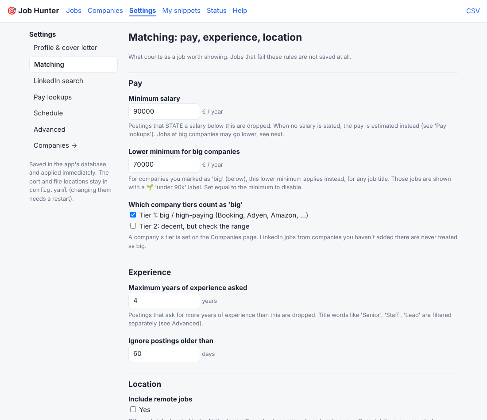

# Job Hunter

A self-hosted job board for a Raspberry Pi. It finds **junior / medior software jobs in the Netherlands** on company
career sites and LinkedIn, removes what doesn't fit (too senior, wrong role, pays too little, outside NL), ranks the rest
against *your* skills, estimates the pay when a posting doesn't state it, and gives you one dashboard to review, apply
and keep track.

**Free** (no paid APIs or accounts) · **everything configurable from the dashboard** · **self-explanatory UI** with a built-in Help page.


## Quick start (Raspberry Pi, with Docker: recommended)

```bash
git clone https://github.com/CRamaker-cmd/Job-openings-tools && cd Job-openings-tools
docker compose up -d --build
```
Open `http://<pi-hostname>.local:8787`, then follow the **Getting started** checklist on the Jobs page:
fill in your profile → check the companies list → press **Scrape now**. After that it keeps itself fresh in the background.
Everything lives in one removable container (`docker compose down -v --rmi local` deletes it all). Details, backup, updates and
Docker installation: [docs/DOCKER.md](docs/DOCKER.md). Without Docker: `./deploy/install.sh` (systemd) or run it by hand
(`python -m venv .venv && .venv/bin/pip install -r requirements.txt && .venv/bin/python -m jobhunter serve`).

> The dashboard has no login: keep it on your home network and **never port-forward it**.
> Port 8787 was chosen to stay clear of Pi-hole; change it in `compose.yaml` (Docker) or `config.yaml`.

### Quiet by design (it shares your Pi with a media server and Pi-hole)

Each company is refreshed **once a day**, **one at a time** (about one an hour), at the **lowest CPU priority**, and only
**new** job postings are processed: anything already saved is skipped, and a role that a company re-opens for a new batch
is recognised as new. In the container it is capped (1 core, 1 GB, `oom_score_adj` so it is stopped first if memory runs out)
and idles at roughly **34 MB RAM / 0.02 % CPU**. See [docs/DOCKER.md](docs/DOCKER.md#made-for-a-shared-pi).

## What you can do in the dashboard

| Page | |
|---|---|
| **Jobs** | Ranked list with filters, pay labels, **Apply ↗**, star / hide, status tracking (new → starred → applied → interview → rejected), stats, setup checklist and a "how to read this" legend. |
| **Job details** | Description, *why this score*, **cover-letter draft** with copy button, notes, status buttons. |
| **Companies** | Add / edit / pause / remove / **test** the employers that are searched. |
| **Settings** | Profile & skills, pay rules, big-company exception, LinkedIn search, pay lookups, schedule, advanced title rules. Saved instantly, each page resettable. |
| **My snippets** | One-click copy of your details for application forms. |
| **Status** | Result of the last scrape per source, schedule, manual-search links. |
| **Help** | How everything works, in the app. |

| | |
|---|---|
|  |  |

## How it decides

- **Drops** senior/staff/principal/lead/manager titles, interns, non-software roles, jobs outside NL, postings asking for more
  than N years, and postings that **state** a salary below your minimum.
- **Ranks** (0-100) on junior/medior wording, your weighted skills, pay, company and freshness.
- **Pay when not stated**: reported-pay table → quick web search (Glassdoor / Levels.fyi / Indeed snippets) → assumption for big
  companies. Every figure shows its source.
- **Big-company exception**: you'd take a bit less for career potential, so at Tier 1 companies the minimum drops from €90k to
  a €70k floor (any job title). Both numbers are settings.
- **Applying**: the app does **not** auto-submit applications; it opens the company's page and gives you the cover letter, your
  snippets and tracking. Details in the [user guide](docs/USER_GUIDE.md#3-applying).

## Sources

Public feeds for Greenhouse, Lever, Ashby, SmartRecruiters, Workday, Jibe (Booking.com), Amazon, Uber · a headless browser for
sites with no feed (Google, Meta, Apple, Microsoft; optional install) · LinkedIn's public search.
Default companies: Amazon, Uber, Booking.com, Palantir, Adyen, Databricks, Datadog, Elastic, Stripe, MongoDB, Cloudflare, GitLab,
Twilio, Okta, Adobe, Salesforce, NVIDIA, Google, Meta, Apple, Microsoft. Add any other on the Companies page.

## Documentation

| | |
|---|---|
| [docs/USER_GUIDE.md](docs/USER_GUIDE.md) | Walkthrough of every page, scoring and pay labels, applying, companies, privacy |
| [docs/SETTINGS.md](docs/SETTINGS.md) | Every setting, its default and effect (generated from the code) |
| [docs/DOCKER.md](docs/DOCKER.md) | Running in Docker, backups, updates, resource use on a shared Pi |
| [docs/TROUBLESHOOTING.md](docs/TROUBLESHOOTING.md) | Failed sources, LinkedIn blocks, pay oddities, port conflicts |
| [docs/ARCHITECTURE.md](docs/ARCHITECTURE.md) | Modules, data flow, design decisions, how to extend (for developers) |

## Honest caveats

- The default company endpoints and the Google/Meta/Apple/Microsoft link patterns were written from public knowledge and
  **could not be tested live** (the dev sandbox blocks job sites); parsers are unit-tested on sample payloads and the browser
  engine on a local JS-rendered page. On your Pi, use **Companies → Test** and fix or pause what fails; a failing source never
  stops the others.
- **LinkedIn's terms forbid scraping.** Only the logged-out public search is used, at low volume, never your account; it may
  break or get your IP blocked for a while. It can be switched off in Settings.
- Pay figures that aren't *stated* are estimates, mostly total compensation (incl. stock/bonus), self-reported and sometimes old.
- The cover letter is a template: read and personalise it before sending.

## Development

```bash
python -m venv .venv && .venv/bin/pip install -r requirements-dev.txt && .venv/bin/python -m pytest
python tools/gen_settings_doc.py      # after changing settings.py, regenerates docs/SETTINGS.md
```
